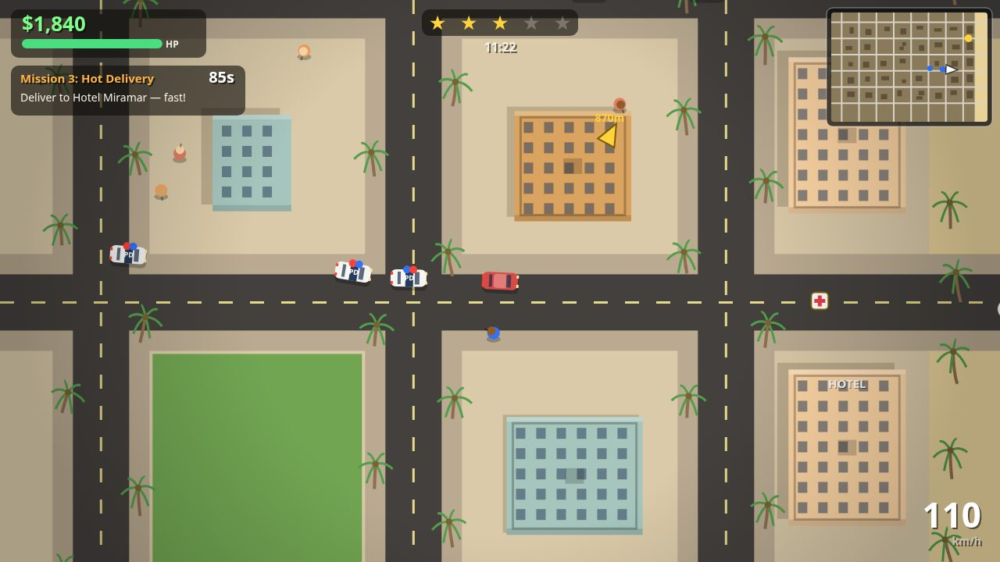
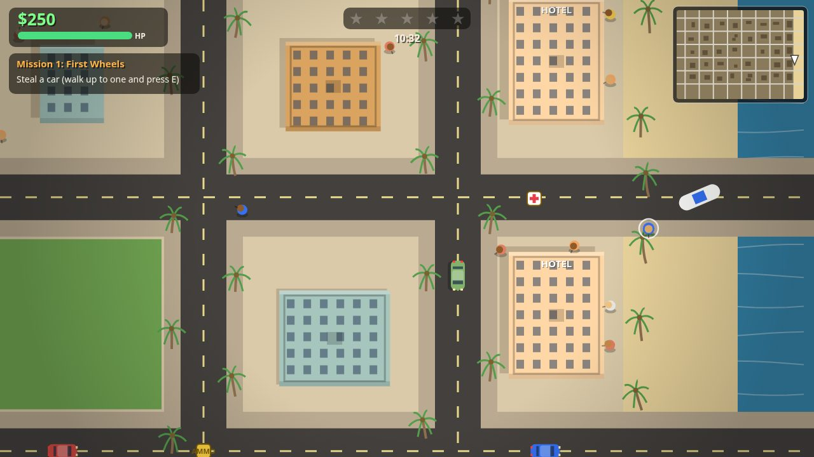
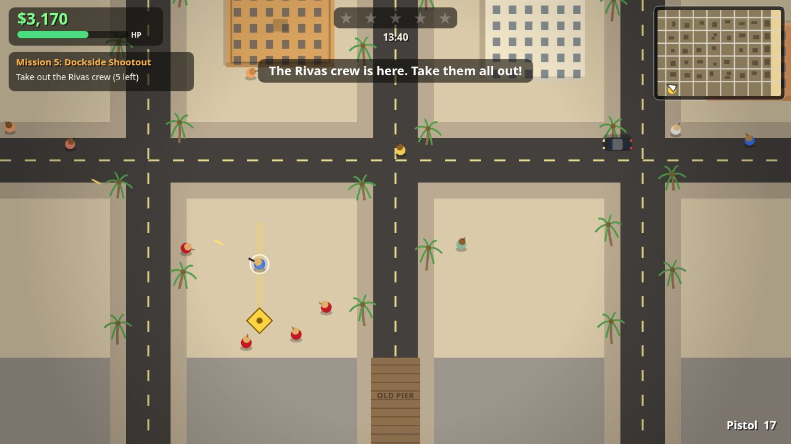
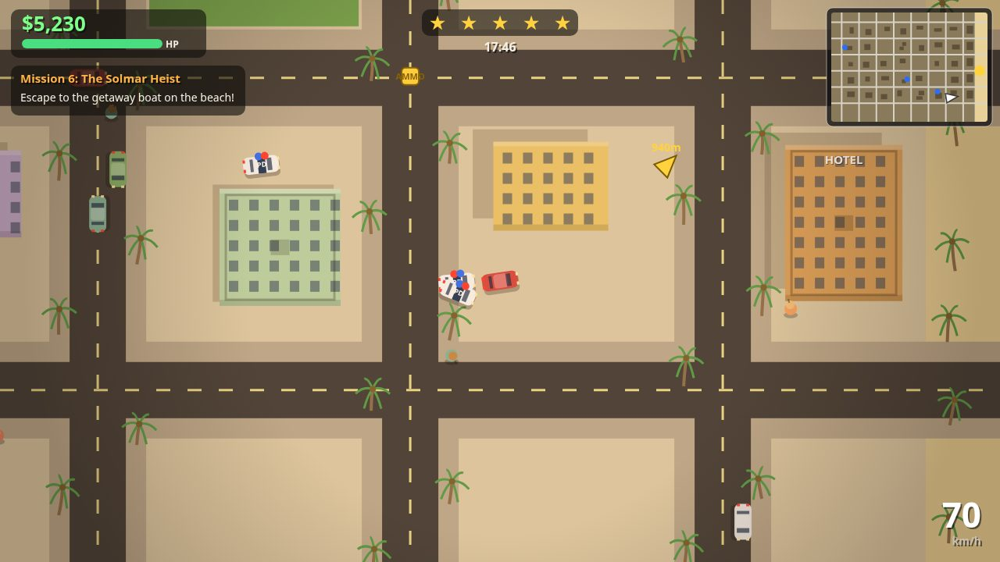

# Solmar — an open-world crime story

[](https://make.fun/bounty/gta6-01)
[](https://make.fun/bounty/gta6-01)
[](https://make.fun/bounty/gta6-01)

An original top-down open-world crime game for the [make.fun "Make GTA 6" bounty](https://make.fun/bounty/gta6-01). You are Danny Reyes, a wheelman fresh out of the Solmar docks. Fixer Marisol Vega has six jobs for you — if you can drive, steal, shoot and vanish well enough to earn them.

**Solmar** is a sun-soaked coastal city of your own: avenues and streets, pastel stucco blocks, two parks, a plaza with a fountain, beachfront hotels, a pier, docklands and the sea. Everything is original — city, characters, vehicles, story, art, sounds and music. No Rockstar content, no external assets, no network requests. Vanilla JavaScript + Canvas 2D, all of it authored for this entry.

## Play it

Serve `game/` with any static server and open `index.html` in desktop Chrome:

```sh
node serve.ts
# then open http://localhost:8080
```

No build step, no dependencies. Save games live in `localStorage`.

## What's in the city

- **On foot and behind the wheel** — WASD to walk (Shift to run), E to enter a car, W/S to accelerate and brake, A/D to steer, Space for a handbrake drift.
- **Stealable cars** — parked cars are free; jacking an occupied one raises your wanted level and its driver flees.
- **Traffic and pedestrians** — cars follow the road grid and stop for each other; pedestrians stroll the sidewalks and run from gunfire.
- **Wanted, 1–5 stars, and the Solmar PD** — police cars spawn, chase and ram; stay quiet and out of sight and the heat dies down. Get caught on foot and you get busted.
- **Six story missions for Marisol Vega** — steal a car, pick up a package, a 90-second hot delivery, losing the cops, a dockside shootout against the Rivas crew, and the Solmar Heist: crack the bank vault and escape to the getaway boat. Cash rewards, progression, and free roam when the story is done.
- **Combat** — pistol (mouse aim, click to shoot) and melee (V), ammo and health pickups around the city, armed thugs who shoot back.
- **HUD** — cash, health, wanted stars, in-game clock, mission objective, speedometer, ammo, and a live minimap with roads, the mission marker and police.
- **Sound** — synthesised WebAudio throughout: engine hum, two-tone sirens, gunshots, pickups and a bass-and-hat loop. M mutes.
- **Save / continue** — pause with P, save with S, continue from the title screen.

## Screenshots

The cover is a timed delivery with three stars on your tail; the others show the beachfront on foot, the dockside shootout, and the five-star heist escape.






## Layout

- `game/index.html` — the page; `game/src/main.js` boots the loop and the screens.
- `game/src/config.js` — tuning, palette, places and the six missions.
- `game/src/world.js` — the seeded city: roads, blocks, buildings, beach, docks.
- `game/src/game.js` — the state machine: update, interactions, collisions, respawn.
- `game/src/entities.js` — the player, car physics, traffic and pedestrians.
- `game/src/police.js` — the wanted system and police chases.
- `game/src/missions.js` — the story step machine.
- `game/src/combat.js` — pistol, melee, bullets, thugs, pickups.
- `game/src/render.js` — the city, the HUD and the minimap.
- `game/src/audio.js` — synthesised WebAudio sound and music.
- `game/src/save.js` — localStorage save/load.
- `game/src/input.js` — keyboard and mouse.
- `game/src/shots.js` — the four screenshot scenes (`?shot=cover|street|mission|chase`).
- `main.ts` — the make.fun entry program: copies `game/` and `screenshots/` to `/output` and writes `dossier.json`.

## License

MIT — see [LICENSE](LICENSE).
